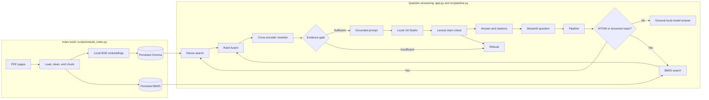

# Architecture

IIITDM Knowledge RAG answers questions using passages from the PDFs in `data/raw/`. The Streamlit app is the UI; the pipeline is implemented in Python modules under `src/`. LM Studio serves the generation model locally through its OpenAI-compatible endpoint.

## Components

- `src/ingestion.py`, `cleaning.py`, and `chunking.py` load one page per PDF document, preserve source, title, category, and 1-based page metadata, remove basic extraction artifacts, and split pages into overlapping text chunks.
- `src/embeddings.py` loads `BAAI/bge-small-en-v1.5` for both document and query embeddings. `src/dense_retrieval.py` stores and searches those vectors in Chroma.
- `src/bm25.py` builds and searches the persisted keyword index.
- `src/hybrid_retrieval.py` combines dense and BM25 ranks with reciprocal rank fusion. `src/reranker.py` sorts the candidates with a local cross-encoder and returns the top results.
- `src/evidence_gate.py` checks reranker scores before generation. If evidence is weak, `src/query_reformulation.py` appends fixed category terms and the pipeline retries up to the configured limit.
- `src/prompt.py` formats the evidence and instructions. `src/llm.py` calls the configured local LM Studio model.
- `src/verification.py` checks answer claims using lexical overlap with cited evidence. `src/citations.py` carries the retrieved documents’ titles and page numbers into the result.
- `app.py` displays the result returned by `src/pipeline.py`.

## Query path

## Why this design

Dense retrieval can match paraphrases; BM25 can match exact policy terms, dates, and course codes. Reciprocal rank fusion combines their rankings without treating their scores as directly comparable. The cross-encoder then scores each query and passage together. The generation model remains local, and the gate can refuse before generation when the reranker scores do not clear the configured threshold.

## Limitations

- Reranker scores and the configured gate threshold have not been validated against a labeled local question set.
- The rule-based retry adds broad category terms; it can help exact-term search but can also introduce unrelated terms.
- The answer verifier uses word overlap. It can reject valid paraphrases and accept statements that share words without being entailed.
- PDF extraction quality and the contents of the indexes constrain what can be answered. Scanned pages may have little or no extractable text.
- Local embedding and reranker model files may require a first-run download. Generation needs LM Studio running with the configured model loaded.
