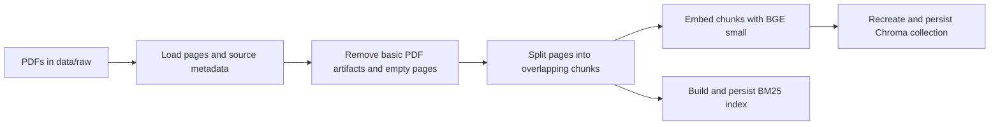
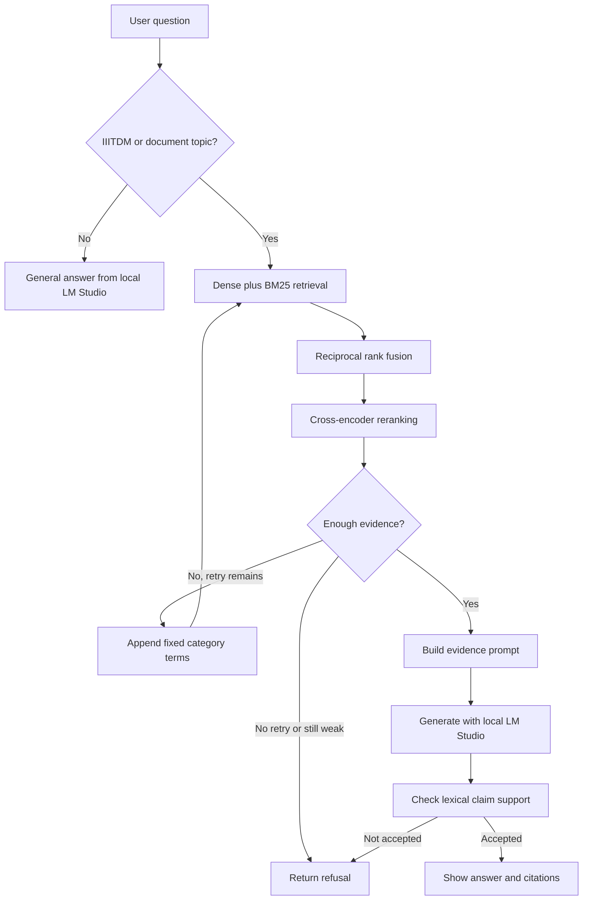

# Project flow

Indexing happens when `scripts/rebuild_index.py` is run. Question answering happens each time a user submits a question in Streamlit. The app does not rebuild indexes on startup.

## Indexing

`src/ingestion.py` extracts PDF pages and records the file name, title, category, and 1-based page number. Cleaning preserves that metadata. Chunking keeps it on each chunk and adds a stable chunk ID. The rebuild script then writes the same chunks to the vector index and the BM25 index. **The rebuild script recreates the Chroma collection and replaces the BM25 index.**

## Question answering

1. `app.py` sends the submitted question to `src.pipeline.answer_question()`.
2. Greetings and app-help prompts get a short fixed response. Other questions are routed by topic: ordinary questions go directly to the local LM Studio model, while IIITDM and institute-document topics continue through RAG.
3. In the RAG route, the pipeline searches Chroma and BM25, combines ranked results with reciprocal rank fusion, and reranks candidates with the cross-encoder.
4. The evidence gate checks reranker scores. If evidence is weak and retries are enabled, the pipeline appends category terms and searches again. If it remains weak, the pipeline returns a refusal without generation.
5. With sufficient evidence, `src.prompt.py` formats the question and passages, then `src.llm.py` sends them to the configured local model. `src.verification.py` checks answer claims for lexical overlap with the retrieved evidence. If accepted, the answer and source/page citations are returned to Streamlit; otherwise, the pipeline refuses it.

Retrieval failure or insufficient evidence should lead to a refusal, not a generated answer based on unrelated context. The verifier is a lexical check, so it is not a guarantee of semantic correctness.
