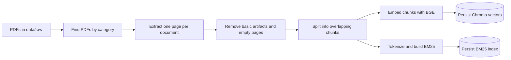
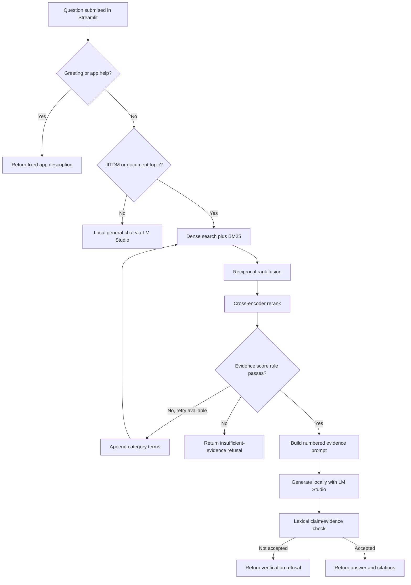

# IIITDM Knowledge RAG: Project Learning Guide

This guide explains how the current project works, from a PDF on disk to an answer in the Streamlit page. It follows the implementation in this repository; it is meant to help you read, run, debug, and explain the project yourself.

## 1. What the project does

The app answers questions using official IIITDM Kancheepuram PDF documents. For institute questions it searches the local indexes, chooses a small set of passages, asks a model running in LM Studio to answer from those passages, and displays source pages. Questions unrelated to IIITDM use a separate general-chat route through the same local LM Studio service. Greetings and questions about the app get a fixed description without retrieval or model generation.

The main idea is **retrieval-augmented generation (RAG)**:

1. Find passages likely to contain the answer.
2. Give those passages and the question to a language model.
3. Show where the answer came from, or refuse when the system decides it cannot answer reliably.

The model does not search the PDFs itself. Python code performs the search and builds the prompt. LM Studio provides local text generation.

## 2. Repository map

| Path | Responsibility |
|---|---|
| `app.py` | Streamlit interface. Collects a question, calls the pipeline, and displays the result. |
| `src/pipeline.py` | Main question-answering orchestrator and `PipelineResult` data structure. |
| `src/ingestion.py` | Finds PDFs and extracts one text document per page with source metadata. |
| `src/cleaning.py` | Conservatively removes extraction artifacts and empty pages. |
| `src/chunking.py` | Splits page text into overlapping chunks and assigns chunk IDs. |
| `src/embeddings.py` | Loads the BGE embedding model used for both documents and queries. |
| `src/dense_retrieval.py` | Writes to and searches the persistent Chroma vector index. |
| `src/bm25.py` | Builds, saves, loads, and searches the keyword index. |
| `src/hybrid_retrieval.py` | Combines dense and BM25 rankings with reciprocal rank fusion. |
| `src/reranker.py` | Reorders hybrid candidates with a cross-encoder. |
| `src/evidence_gate.py` | Applies the configured score and minimum-chunk rule before generation. |
| `src/query_understanding.py` | Routes general versus IIITDM questions and detects a rough topic category. |
| `src/query_reformulation.py` | Adds fixed category terms for one optional retry when evidence is weak. |
| `src/prompt.py` | Numbers passages and creates the evidence-only generation prompt. |
| `src/llm.py` | Calls the OpenAI-compatible LM Studio endpoint and extracts visible answer text. |
| `src/verification.py` | Checks whether generated claims have enough lexical overlap with evidence. |
| `src/citations.py` | Converts retrieved chunk metadata into displayed source/page citations. |
| `scripts/rebuild_index.py` | Explicit indexing entry point; rebuilds both persisted indexes. |
| `scripts/test_lm_studio.py` | Checks that the configured local LM Studio server answers a small request. |
| `evaluation/` | Small source-grounded question set and evaluation scripts. |
| `data/raw/` | PDF input collection, organized into category folders. |
| `storage/` | Persisted Chroma database and BM25 index used by the app. |
| `docs/` | Short reference pages for architecture, flow, frontend, setup, and decisions. |

## 3. Two separate workflows

Indexing is done when you build or rebuild the collection. Question answering happens each time somebody submits a question. Starting Streamlit does not rebuild the indexes.

### 3.1 Indexing workflow

Plain-text view of the indexing flow:

```text
data/raw/<category>/*.pdf
          |
          v
scripts/rebuild_index.py
          |
          v
discover PDFs -> extract each page -> attach filename/page/category/title
          |
          v
clean page text -> discard empty pages -> detect section headings
          |
          v
split each page into overlapping chunks -> copy metadata -> assign chunk_id
          |
          +-------------------------------+
          |                               |
          v                               v
embed chunks with BGE              tokenize chunk text
          |                               |
          v                               v
Chroma vector collection           BM25 keyword index
          |                               |
          +---------------+---------------+
                          v
            persistent files under storage/
```



1. `scripts/rebuild_index.py` calls `load_all_documents()` in `src/ingestion.py`.
2. `PyPDFLoader` extracts each PDF page. Metadata records the PDF filename, a title made from the filename, category, and 1-based page number.
3. `clean_documents()` removes control characters and standalone page numbers, normalizes whitespace, drops empty pages, and tries to detect a section heading. It intentionally preserves meaningful numbers and policy text.
4. `chunk_documents()` uses `RecursiveCharacterTextSplitter`. It tries paragraph, line, sentence, and word boundaries in that order. The defaults are 900 characters per chunk and 125 characters of overlap. Each chunk inherits the page metadata and receives a stable `chunk_id` such as `hostel_rules_p3_c0`.
5. The same chunk collection is saved in two forms:
   - **Chroma:** each chunk gets an embedding from `BAAI/bge-small-en-v1.5`, with normalized vectors. Chroma persists the vectors and metadata under `storage/chroma/`.
   - **BM25:** each chunk is tokenized into lowercase letter/number terms. BM25 data, text, chunk IDs, and metadata are pickled to `storage/bm25_index.pkl`.

The two indexes represent the same chunk set in different ways: Chroma stores vector representations for semantic matching, while BM25 stores terms for lexical matching. The rebuild script resets the Chroma collection and replaces the BM25 file. Do not run it casually if you need to preserve existing indexes.

### 3.2 Question-answering workflow

The app has three outcomes after a question is submitted. This plain-text chart is visible even in editors that do not render Mermaid:

```text
Question submitted in app.py
          |
          v
Is it a recognized greeting/app-help prompt? -- yes --> fixed app description
          |
          no
          v
Does it mention IIITDM or a recognized document topic?
          |                                  |
         no                                 yes
          |                                  |
          v                                  v
general chat through LM Studio         document RAG pipeline
no citations / no index search         retrieve -> rerank -> evidence gate
                                             |
                                      enough evidence?
                                        /         \
                                      no           yes
                                      |             |
                               one retry left?   build evidence prompt
                                /       \             |
                              yes       no            v
                              |          |       LM Studio generation
                     expand query       v            |
                     and search again  refuse        v
                                           verify claims against evidence
                                                    /       \
                                             not accepted   accepted
                                                  |            |
                                                refuse     answer + sources
```

The Mermaid chart below has the same route and makes the retry/refusal branches explicit:



### 3.3 What moves between stages

This table follows the actual data passed between the main functions. It helps locate where a problem starts:

| Stage | Main input | Main output | Metadata/text to inspect |
|---|---|---|---|
| PDF loading | PDF path and category | LangChain `Document` for each page | `page_content`, `source`, `page`, `category`, `title` |
| Cleaning | Page documents | Cleaned page documents | Text remains readable; `section` is added when detected |
| Chunking | Cleaned page documents | Smaller `Document` objects | Same metadata plus `chunk_id`, `chunk_index`, `chunk_size_chars` |
| Dense search | Question string | `DenseCandidate` list | `chunk_id`, similarity-style score, text, metadata |
| BM25 search | Question string | `BM25Candidate` list | `chunk_id`, BM25 score, text, metadata |
| Fusion | Dense and BM25 candidate lists | `HybridCandidate` list | Both ranks and the combined RRF score |
| Reranking | Question plus hybrid candidates | `RerankedCandidate` list | `raw_score`, sigmoid `relevance_score`, text, metadata |
| Evidence gate | Reranked candidates | `EvidenceVerdict` | qualifying count, threshold, minimum required, reason |
| Prompt building | Original question and reranked passages | system and user prompt strings | source labels and exact evidence text |
| Generation | prompts plus local model ID | visible answer text | `message.content` from LM Studio |
| Verification | answer text and reranked passages | `VerificationResult` | extracted claims, lexical support score, supporting source indexes |
| Result/UI | `PipelineResult` | answer, sources, status and diagnostics | citations and evidence retain the source/page metadata |

For example, a chunk can be traced by its ID from the PDF page into both indexes, through the retriever candidate objects, then into the prompt as a numbered source. The citation builder uses the metadata from the reranked evidence, so the document name and page displayed in Streamlit come from that same chunk record.

### 3.4 The UI-to-answer call sequence

When you click **Ask Question**, the important function calls happen in this order:

```text
app.main()
  ├─ render_header()
  ├─ render_question_form()
  └─ answer_question(question)                 src/pipeline.py
       ├─ validate and trim the question
       ├─ is_app_help_input(question)           src/query_understanding.py
       │    └─ fixed app-help result, if matched
       ├─ is_document_question(question)        src/query_understanding.py
       │    ├─ no match -> generate()           src/llm.py (general prompt)
       │    └─ match -> RAG path
       │         ├─ _get_bm25_index()           load persisted keyword index once
       │         ├─ detect_category()           decide retry vocabulary
       │         ├─ _retrieve_and_rerank()
       │         │    ├─ hybrid_search()
       │         │    │    ├─ dense_search()     Chroma + question embedding
       │         │    │    ├─ BM25Index.search()
       │         │    │    └─ fuse_candidates_rrf()
       │         │    └─ rerank()                cross-encoder
       │         ├─ check_sufficiency()          before model call
       │         ├─ optional reformulation + one more retrieval pass
       │         ├─ build_prompt()               source-numbered context
       │         ├─ generate()                   LM Studio grounded call
       │         ├─ verify_answer()              lexical support check
       │         └─ build_citations()            source/page metadata
       └─ return PipelineResult
  ├─ render_answer(result)
  ├─ render_sources(result)
  └─ render diagnostic expanders for RAG results
```

`app.py` does not perform retrieval. It only calls the orchestrator and renders fields of its result. The `PipelineResult.answer_mode` indicates whether the response came from the general route or the document route. General responses do not have citations and are labeled as not grounded in the IIITDM collection.

### 3.5 A concrete retrieval trace

Use the test question **“How early must I give the hostel caretaker my leave form before leaving campus?”** from `evaluation/questions.json` as an example. Its checked target is `20_hostel_rules_and_regulations_2025_2026.pdf`, page 17.

1. The router sees hostel/leave terms and selects the document route.
2. Dense search tries to find passages with similar meaning; BM25 tries to find passages sharing terms such as `hostel`, `leave`, `form`, and `caretaker`.
3. RRF combines the ranks. It does not add raw BM25 and vector scores.
4. The cross-encoder compares this question to each fused passage. The top candidates are sorted by its converted score.
5. If the gate accepts the candidates, the prompt includes the page-17 chunk with a label such as `[Source 1]`, its filename and page metadata, and its text. The exact source number depends on the reranked order for that run.
6. LM Studio generates an answer using that prompt. The answer must cite `[Source 1]` or another actual prompt label.
7. The verifier checks the answer's claim words against the evidence chunk(s) referenced by the source label. The app then displays the answer and the filename/page citations.

This trace describes how data should move; it is not a claim that the current local model produced a particular answer. To establish actual answer quality, run the question on your machine with LM Studio and the embedding/reranker models available, then inspect the returned evidence and answer.

The current route rules are simple keyword rules, not a trained classifier. `is_app_help_input()` catches a small set of exact greetings/help phrases. `is_document_question()` searches for IIITDM and document-topic keywords. If no document topic matches, the question is sent to general chat without RAG sources. A question about IIITDM documents goes through retrieval.

In the RAG path:

1. **Dense retrieval** embeds the question with the same BGE model used during indexing and searches Chroma. Using the same model keeps query vectors compatible with stored document vectors.
2. **BM25 retrieval** tokenizes the question and ranks passages with matching terms. This helps with exact terms such as form names, abbreviations, dates, and policy words.
3. **Reciprocal rank fusion (RRF)** combines the two ranked lists. It uses ranks, not the raw dense and BM25 scores, because those scores have different scales. A chunk found by both methods gets a contribution from both lists. The formula is `sum(1 / (k + rank))`; the default `k` is 60.
4. **Reranking** passes each candidate together with the question to `cross-encoder/ms-marco-MiniLM-L-6-v2`. This is slower than vector search, so it only runs on the smaller hybrid candidate list. The default is up to 20 candidates into the hybrid stage and 5 after reranking.
5. **Evidence gate** counts valid chunks whose sigmoid-converted reranker score is at least 0.5. The default minimum is 2 qualifying chunks. These settings are in `src/config.py` and can be overridden through `.env`.
6. If the gate fails and one retry is configured, `src/query_reformulation.py` appends fixed terms for the detected category and the pipeline repeats retrieval/reranking once. If it still fails, the pipeline returns a refusal before calling the model.
7. `src/prompt.py` formats each nonempty passage as `[Source N]` with document, page, section, and evidence text. It instructs the model to use only those passages and cite factual statements.
8. `src/llm.py` sends a system and user message to LM Studio’s OpenAI-compatible local endpoint. Its client is created once and cached. The code returns visible `message.content`; it does not use hidden reasoning as an answer.
9. `src/verification.py` splits the answer into claim-like lines/sentences and checks meaningful word overlap with the cited evidence (or all evidence if there are no citations). If the draft does not pass, the pipeline may ask the model once more with the same prompt, then keeps the better lexical result or refuses.
10. `src/citations.py` makes the UI source list from the reranked evidence metadata. `PipelineResult` carries the answer, citations, evidence chunks, route, and diagnostics back to Streamlit.

## 4. Important terms, in plain language

- **Document/page:** A PDF is extracted one page at a time. The original page number is retained for citations.
- **Chunk:** A smaller slice of page text. Search usually works better over focused passages than entire long PDFs. Overlap helps preserve context near chunk boundaries.
- **Embedding:** A list of numbers representing text meaning. Similar questions and passages can be close in vector space even when they use different words.
- **Dense/vector search:** Finds passages whose embeddings are similar to the question embedding.
- **BM25:** A keyword ranking method. It rewards matching terms while accounting for how common they are in the collection and passage lengths.
- **Hybrid retrieval:** The project combines semantic dense results and exact-term BM25 results.
- **RRF:** A rank-combining formula that lets the system combine rankings without comparing incompatible score scales.
- **Cross-encoder:** A model that reads the question and one passage together to estimate relevance. It is used after retrieval because it costs more than searching embeddings.
- **Grounding:** The desired behavior where factual answer statements are supported by the retrieved source passages.
- **Citation:** A displayed source title and page. Citation metadata identifies the evidence; it is not itself proof that the claim is true.

## 5. Configuration to know

`src/config.py` reads environment variables first, then the project `.env`, then defaults. Relative paths are interpreted from the repository root. The `.env.example` is a template; `.env` contains your machine-specific settings and should not be committed.

Common settings include:

| Setting | Current default/purpose |
|---|---|
| `LM_STUDIO_BASE_URL` | `http://127.0.0.1:1234/v1`, local generation endpoint. |
| `LM_STUDIO_MODEL` | Exact model ID loaded in LM Studio; set this in `.env`. |
| `EMBEDDING_MODEL_NAME` | `BAAI/bge-small-en-v1.5`. Keep consistent with the existing Chroma index. |
| `RERANKER_MODEL_NAME` | `cross-encoder/ms-marco-MiniLM-L-6-v2`. |
| `CHUNK_SIZE` / `CHUNK_OVERLAP` | 900 / 125 characters. Changing them requires re-indexing to take effect. |
| `DENSE_TOP_K` / `BM25_TOP_K` | 20 candidates from each retriever. |
| `HYBRID_TOP_K` / `RERANK_TOP_K` | Hybrid candidate limit 20; final reranked limit 5. |
| `EVIDENCE_SCORE_THRESHOLD` / `EVIDENCE_MIN_CHUNKS` | 0.5 score and 2 qualifying chunks. These are heuristics, not a validated confidence guarantee. |
| `MAX_QUERY_REFORMULATION_RETRIES` | One bounded retry by default. |

## 6. How to run it

Activate the Python environment in PowerShell, make sure LM Studio is running with a loaded local model, then start the app:

```powershell
conda activate langchain_env
python scripts/test_lm_studio.py
streamlit run app.py
```

The LM Studio check confirms the local chat endpoint/model works. It does not verify the retrieval indexes. The app needs the existing `storage/chroma/` and `storage/bm25_index.pkl` files. Only rebuild after changing the PDF collection or index settings:

```powershell
python scripts/rebuild_index.py
```

The embedding and reranker weights may need to be available locally on first use. A package/model download may require internet access; normal question answering uses the local LM Studio endpoint and local persisted indexes.

## 7. How to debug a wrong answer

Follow the data from the beginning instead of immediately changing the prompt:

1. **Was the question routed correctly?** Check whether it should use general chat or document QA. The router is keyword-based, so an unfamiliar phrase can choose the wrong route.
2. **Did extraction preserve the passage?** Inspect the original PDF page and the text returned by `src/ingestion.py`. Image-only scanned pages may not yield searchable text because this project does not add OCR.
3. **Did the right chunk get indexed?** Confirm source filename, 1-based page, section, and chunk ID. A rebuilt index is needed after document or chunking changes.
4. **Did retrievers find it?** Compare dense and BM25 results separately when debugging. A result from only one retriever is still kept by RRF; agreement from both increases its rank.
5. **Did the reranker move it?** The reranker receives only the hybrid candidate list. If the correct passage was not retrieved in that list, reranking cannot recover it.
6. **Did the evidence gate accept or reject?** Inspect score and qualifying count. The score is a model-derived heuristic, not a calibrated probability that the passage answers the question.
7. **Did the prompt contain the expected text and source number?** `src.prompt.format_evidence_context()` shows the exact form passed to generation.
8. **Did the answer preserve the source's conditions?** A fluent answer can still misread a condition. The current lexical verifier can catch some unsupported wording but cannot prove entailment.
9. **Does the citation match the passage metadata?** Check the filename and page attached to the exact chunk. A source citation says where evidence came from; inspect the passage to confirm it supports the sentence.

## 8. Known limits

- The route detector uses keywords and can misroute questions. It is intentionally small and inspectable.
- The fixed retry terms can introduce broad, unrelated terms; a retry does not guarantee better evidence.
- The gate threshold has not been calibrated using a large, labeled question set. Two chunks above a score threshold do not prove that the question is answered.
- The verification check measures lexical overlap. It may reject a correct paraphrase or accept a sentence that repeats words without preserving their meaning.
- The small evaluation set is for smoke checks, not a benchmark or a claim about overall accuracy.
- PDF text extraction quality limits retrieval; scanned/image-based pages may not be searchable.
- Retrieval and generation are separate: the local LM Studio model can only answer from the supplied context on the RAG path, but prompt instructions and lexical checks cannot guarantee perfect behavior.

## 9. A short interview explanation

> “I built a local document question-answering app. At indexing time, it extracts PDF pages, preserves page metadata, cleans and splits the text, then stores the same chunks in a Chroma vector index and a BM25 keyword index. At question time, the app routes ordinary chat separately from IIITDM document questions. For document questions it combines semantic and keyword rankings with reciprocal rank fusion, reranks the candidates with a cross-encoder, checks a simple evidence threshold, and sends the numbered passages to a model served locally by LM Studio. The app displays source pages and refuses when its evidence or lexical answer check fails. The checks help, but they are heuristics; they do not prove semantic correctness.”

## 10. Suggested reading order in the code

Read these in sequence to follow one complete question:

1. `app.py` — find where the button submission calls `answer_question()`.
2. `src/pipeline.py` — trace routing and the sequence of stages.
3. `src/query_understanding.py` — understand the two question routes.
4. `src/hybrid_retrieval.py` — follow dense/BM25 result fusion.
5. `src/reranker.py` and `src/evidence_gate.py` — see how candidates are reordered and gated.
6. `src/prompt.py` and `src/llm.py` — inspect what is sent to LM Studio and how its response is returned.
7. `src/verification.py` and `src/citations.py` — see the limits of answer checking and how page sources are produced.
8. `scripts/rebuild_index.py` — trace the separate PDF-to-index workflow.
